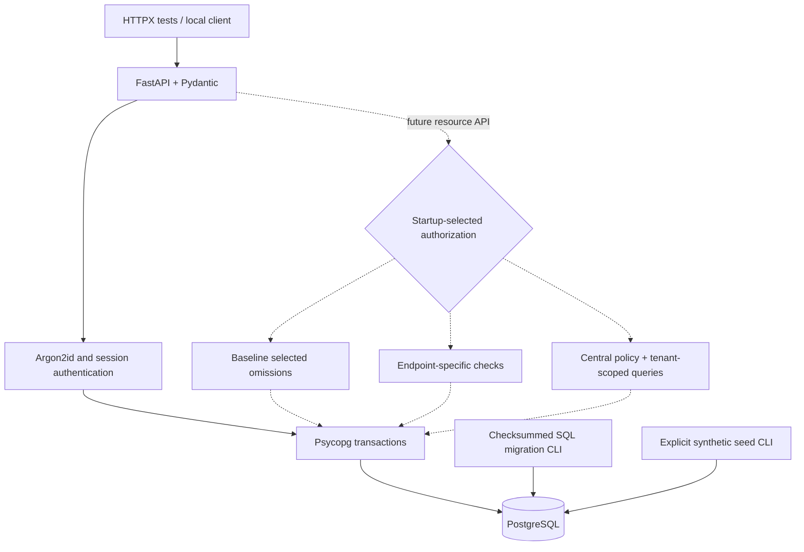
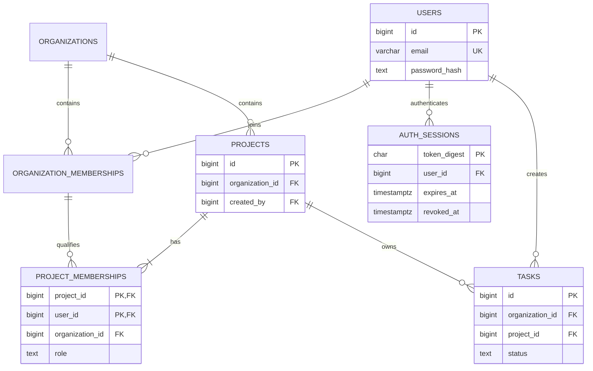

# Architecture and schema

M1 uses synchronous FastAPI handlers, strict Pydantic credentials, opaque sessions, Psycopg transaction
contexts, SQL migrations and a seed CLI. Connections have connection/statement/lock timeouts.
Writes commit before handlers return. There is no ORM or extra migration framework.

Composite foreign keys enforce matching tenant/project IDs and same-organization project members.
Integer IDs make substitution experiments clear; they are not secrets. A partial unique owner index
prevents two owners; a deferred constraint prevents zero at commit. Owner mutation/removal triggers
also prohibit transfer. Deleting a project removes its memberships/tasks.

Migration application is transactional and uses an advisory lock. `schema_migrations` records names,
SHA-256 digests and application timestamps. Changed/missing applied files are rejected. Startup checks
the exact history. Add migrations rather than editing applied ones; no destructive downgrade exists.

Argon2id uses 19 MiB memory, two iterations, one lane and independent salts. Tokens have 256 random
bits and a maximum 15-minute lifetime. Only SHA-256 token digests are stored, with expiry/revocation.
Fast hashing is suitable for high-entropy tokens, not human passwords. No roles are stored in tokens.

Fixture equivalence fixes IDs, content and timestamps; password salts and issued tokens correctly
remain random. Authentication establishes identity; future membership policies establish permissions.
